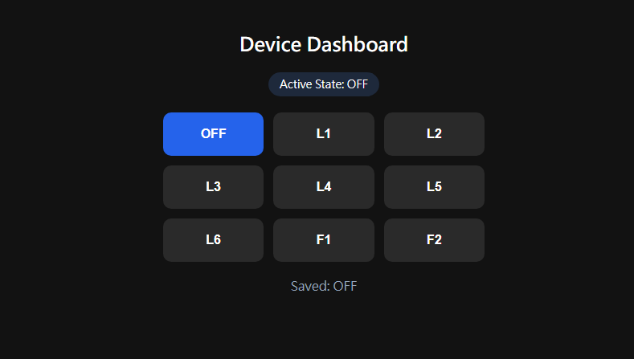

# ESP_Car : IoT Vehicle Controller
*This is a low effot readme made with duck.ai beware of errors as i dont really care about this readme as it is only for the sake of one single index.html's existance.

A simple web interface for sending vehicle-control states to an ESP32 through a Cloudflare Worker and Cloudflare KV storage.

## Screenshots

Add screenshots of the page to the `screenshots/` folder, using these filenames, or update the paths below.

### Desktop



### Mobile


## Features

- Displays the current device state.
- Sends a selected state to the Worker.
- Refreshes the displayed state every two seconds.
- Uses a responsive layout for desktop and mobile screens.

## How it works

The Worker uses Cloudflare KV to store the current state under the key `led`.

- `GET /status?key=...` returns the current state as plain text.
- `GET /set?key=...&state=...` saves a new state.

Accepted states are `OFF`, `L1`–`L6`, and `F1`–`F2`.

The ESP32 must read the stored value and interpret those states. The web page and Worker do not directly control hardware unless the ESP32 is configured to do so.

## Setup

1. Create a Cloudflare Worker and bind a KV namespace to it as `ESP32_STORE`.
2. Set a Worker secret named `CONTROL_KEY`. Use that secret for request authentication rather than hard-coding a password in the source.
3. Deploy the Worker over HTTPS.
4. Open the Worker’s URL in a browser and provide the configured key if your implementation uses a query parameter for authentication.
5. Configure the ESP32 to read the `led` value from the same KV namespace or through an authenticated Worker endpoint.

## Configuration

The Worker expects a KV binding named:

```text
ESP32\_STORE
